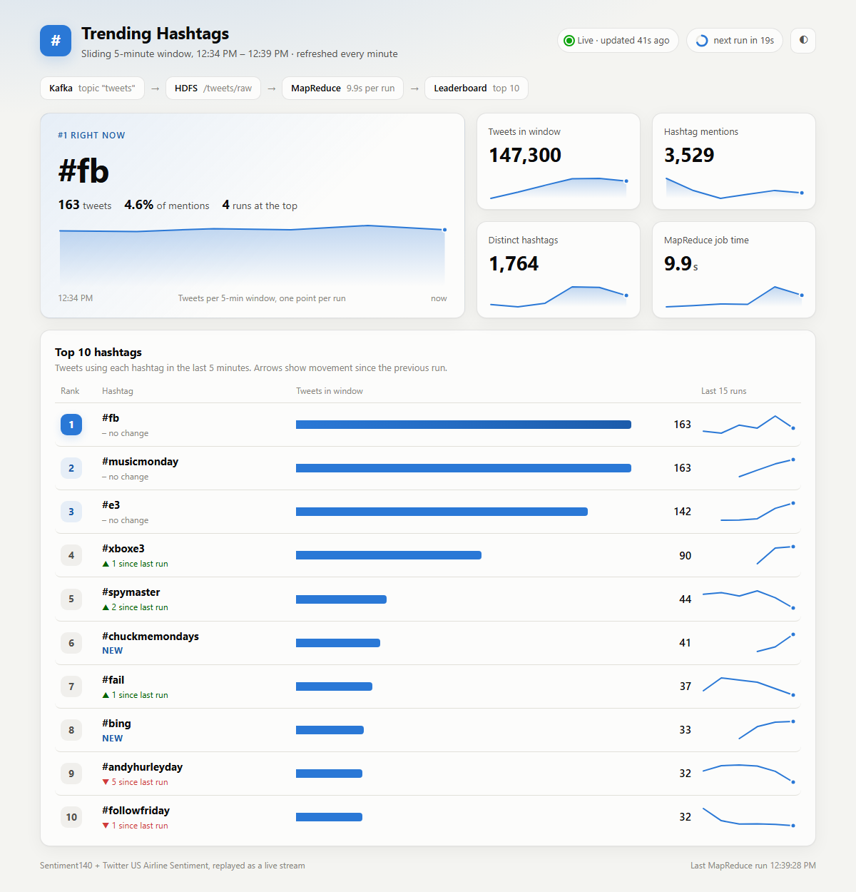

# Real-Time Trending Hashtag Detection

Tweets are streamed through Kafka, stored on HDFS, and a MapReduce job counts
hashtags over a sliding 5-minute window every minute. The top 10 are shown on a
live leaderboard dashboard.

```
Sentiment140 + Airline CSVs
        |  producer/tweet_producer.py     replays tweets as live events
        v
   Kafka topic "tweets"
        |  consumer/kafka_to_hdfs.py      lands events on HDFS every ~10 s
        v
   HDFS /tweets/raw/YYYYMMDD/HHMM/part-*.jsonl      (one directory per minute, UTC)
        |  scripts/run_trending_job.py    every 60 s: Hadoop Streaming job over the last 5 minutes
        |      mapreduce/mapper.py        tweet -> (hashtag, 1), filtered to the window
        |      mapreduce/combiner.py      map-side sum
        |      mapreduce/reducer.py       sum + keep the top 10
        v
   HDFS /tweets/trending/latest.json      (job outputs kept in /tweets/trending/runs/)
        |  dashboard/app.py               Flask, reads latest.json over WebHDFS
        v
   http://localhost:5000
```



## Setup

**Requirements:** Windows, Java 8, Python 3.11+, Apache Hadoop 3.3.6 (single-node HDFS,
with `winutils.exe`), Apache Kafka 2.3.1. The install locations are set in `config.py`
(`HADOOP_HOME`, `JAVA_HOME`) and `scripts/start_services.ps1` / `scripts/supervisor.py` (Kafka).

```powershell
pip install -r requirements.txt
```

**Datasets** (not in the repository; Sentiment140 is 228 MB):

- [Sentiment140](https://www.kaggle.com/datasets/kazanova/sentiment140): save
  `training.1600000.processed.noemoticon.csv` in `sentiment/`.
- [Twitter US Airline Sentiment](https://www.kaggle.com/datasets/crowdflower/twitter-airline-sentiment):
  save `Tweets.csv` in `airline/`.

## Run

**Easiest:** double-click the **Trending Hashtags** shortcut on the desktop (or run
`scripts\launch.ps1`). It starts `scripts\supervisor.py`, which starts every service and
stage that is not already running, keeps them running (including after the laptop sleeps),
and opens the dashboard. The dashboard's **Producer** switch pauses or resumes the tweet
stream; a producer switched off stays off.

Alternatively, from this folder, in PowerShell:

```powershell
powershell -ExecutionPolicy Bypass -File scripts\start_services.ps1   # HDFS, ZooKeeper, Kafka, topic
powershell -ExecutionPolicy Bypass -File scripts\start_pipeline.ps1   # sink, trend job, dashboard, producer
```

Each stage opens in its own window; close a window to stop that stage, or stop
everything with `scripts\stop_all.ps1` (add `-IncludeHdfs` to stop HDFS too; it stops the
supervisor first, otherwise the supervisor would restart what you stop).
For the presentation, follow `presentation\RUN_SHEET.md`. The
dashboard opens at http://localhost:5000 and fills in after the first job run
(about a minute).

To run stages by hand instead:

```powershell
python consumer\kafka_to_hdfs.py
python scripts\run_trending_job.py            # add --once for a single run
python dashboard\app.py
python producer\tweet_producer.py --rate 500  # tweets per second
```

## Notes

- **Datasets.** `sentiment/` holds Sentiment140 (1.6M tweets, April to June 2009) and
  `airline/Tweets.csv` the Twitter US Airline Sentiment set (14,640 tweets, February 2015).
  The producer replays Sentiment140 in chronological order and mixes in one airline tweet
  per 110. Each event is stamped with the current time, so the window is over arrival time.
  At 500 tweets/s the full replay lasts about 55 minutes; only about 2% of tweets carry a hashtag.
- **MapReduce mode.** The job runs with `mapreduce.framework.name=local` by default: a real
  MapReduce job reading from and writing to HDFS, but run in the client JVM so it finishes in
  a few seconds. Pass `--framework yarn` (after `start-yarn.cmd`) to submit it to YARN instead.
- **Settings** (window length, slide interval, top N, ports, paths) are in `config.py`.
